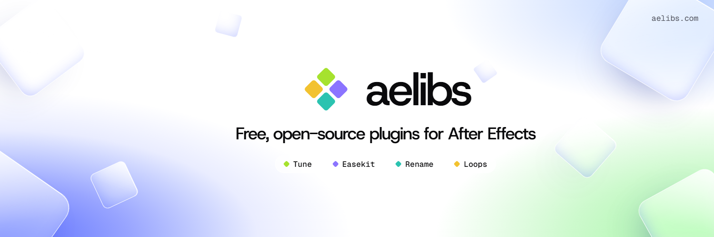

<picture>
  <source media="(prefers-color-scheme: dark)" srcset="assets/banner-dark.png">
  
</picture>

Free, open-source plugins for After Effects. MIT-licensed, for macOS and Windows, After Effects 2020 to 2026.

### Out now

&nbsp; **[Tune](https://github.com/aelibraries/tune)**: finds what makes a project slow and fixes it, from proxies to baked expressions. Draft mode turns a comp down while you work, then puts back exactly what it changed.

&nbsp; **[Easekit](https://github.com/aelibraries/easekit)**: a curve editor that docks next to your timeline. Shape an ease, save it to your library and apply it to keyframes on any property.

### Coming soon

&nbsp; **Rename**: batch-renames layers, comps, footage and folders with tokens or regex.

&nbsp; **Loops**: copy-paste expressions for seeded wiggles, ping-pong loops and inertial bounce.

---

[aelibs.com](https://aelibs.com) · [contact@aelibs.com](mailto:contact@aelibs.com)
